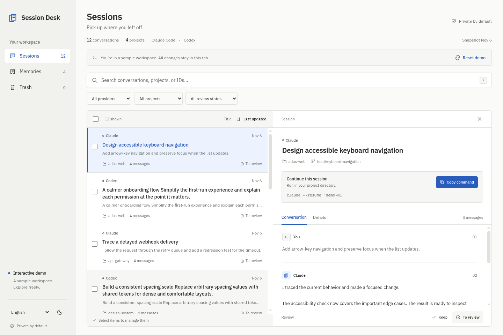

# Session Desk

A local workspace for Claude Code, Codex, and Antigravity conversations. Find a message,
recover context for your next session, and keep useful decisions as linked notes.
Your data stays on your computer.

[Open the synthetic demo](https://aalvaropc.github.io/session-desk/)



## Get started

Requires Python 3.9+ and [uv](https://docs.astral.sh/uv/).

```sh
uv tool install git+https://github.com/aalvaropc/session-desk.git
session-desk start --open
```

The server keeps running after you close the terminal. Manage it with `session-desk status` and `session-desk stop`. It listens on `127.0.0.1` and does not start automatically after a reboot.

From a source checkout, use `uv run session-desk start --open`. To explore without reading your files, run `uv run session-desk start --demo --open` and stop the current instance first if needed.

## What it does

- Searches complete readable conversations, shows a match preview, and jumps to the message.
- Copies a resume command or a Markdown brief with the last request, last reply, project, and branch where available.
- Groups recent sessions by project and provider and opens the conversations behind each count.
- Saves editable notes linked to a message and exports them to Markdown.
- Moves Claude Code and Codex sessions and Claude project memories to recoverable trash.
- Exports a read-only HTML snapshot with `session-desk --static -o sessions.html`.

| Source | Default discovery | Continue | Recoverable trash |
| --- | --- | --- | --- |
| Claude Code | `~/.claude` | `claude --resume` | Sessions and project memories |
| Codex | `$CODEX_HOME` or `~/.codex` | `codex resume` | Sessions |
| Antigravity CLI | `~/.gemini/antigravity-cli` | `agy --conversation` | — |
| Antigravity App | `~/.gemini/antigravity` | Conversation search in the App | — |
| Antigravity IDE | `~/.gemini/antigravity-ide` | History in the agent side panel | — |

The project filter includes sessions in subfolders and in worktrees stored under the
selected project. Claude subagent transcripts are auxiliary records and are grouped
with their provider session history on disk.

Antigravity reads the available JSONL and the summary database. Conversations whose text
is stored only in an opaque native file appear as metadata. Session Desk opens
Antigravity source files for reading. Use `--antigravity-home` to replace the shared
parent directory.

## Local storage

The live workspace keeps a searchable copy of readable messages under Session Desk's
private local state directory. The saved catalog is available while Session Desk checks
for changed transcripts in the background. Refresh starts another check, and the panel
shows how many sessions are searchable during the update. On a fresh workspace,
recent sessions become searchable in batches. A restart picks up from the last saved
batch. Searches and reading stay available during later refreshes. Reviews, notes and trash changes resume after the update completes.
Run `session-desk stop` and then `session-desk reindex` to rebuild the searchable copy.
Pass the same custom provider roots when applicable. Reindex retains saved reviews and
notes. HTML exports can contain private text and include conversation previews.

## Development

```sh
uv sync --group dev
npm ci --ignore-scripts
npm run build
uv run python -m unittest discover -s tests
npm run test:unit
npm run test:e2e
```

To build a standalone synthetic demo locally, run
`uv run session-desk --demo --static -o demo.html` and open the resulting file. The
**Publish synthetic demo** workflow deploys that same export. It runs on demand once
GitHub Pages is configured to use GitHub Actions.

The TypeScript interface is bundled into the Python package. See [architecture](docs/architecture.md), [contributing](CONTRIBUTING.md), and the [MIT license](LICENSE).
