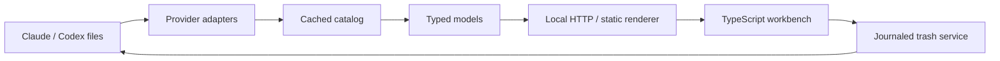

# Architecture

Session Desk runs on loopback and reads provider files directly. There is no hosted
backend, account, telemetry endpoint or runtime database of its own. The Python package
contains the compiled interface, fonts and license, so installing a wheel needs no Node.

## Responsibilities

- `cli.py` validates launch options, selects real or isolated demo roots and owns lifetime.
- `background.py` manages a detached instance, private runtime state, launch locking and authenticated status/shutdown.
- `config.py` is the immutable launch configuration.
- `models.py` defines the session, memory, warning, trash and operation-result boundaries.
- `providers/claude.py` and `providers/codex.py` normalize provider transcript formats.
- `providers/codex_index.py` owns the optional versioned Codex SQLite index.
- `services/catalog.py` discovers files and reuses unchanged transcript snapshots.
- `services/state.py` owns roots, identities, fingerprints and scan warnings.
- `services/trash.py` journals reversible filesystem moves and recovery.
- `sessions.py` composes the catalog and trash behind a small facade.
- `rendering.py` serializes bootstrap data safely and reads packaged web resources.
- `server.py` enforces loopback, origin/token checks, bounded bodies and asset routing.
- `frontend/state.ts` owns filtering, validated browser state and context-aware links.
- `frontend/views.ts` builds pure markup from typed view state.
- `frontend/app.ts` coordinates DOM interaction and local/demo operations.
- `frontend/i18n.ts` and `icons.ts` keep translations and icon definitions separate.

The former `panel.py` module is a compatibility facade for the original entry point.
Provider code never imports a UI module. JSON fields name their meaning rather than
using the old `proj`, `msgs` and `kb` abbreviations.

## Data flow

## Recovery

IDs combine a provider with a digest of the relative provider-file path, so copied
native session IDs remain distinct. Versions combine inode, size and nanosecond mtime.
A mutation validates both the displayed version and current file before moving it.

Each removal has a unique directory under the provider's `trash/sessions-panel/` root.
A manifest records original paths and the information required to restore. Claude
session sidecars move with the transcript; memories use the same mechanism. Existing
v0.2 manifests remain readable. Recovery refuses to overwrite a newer/different file.

The current Codex SQLite schema is the only one updated; obsolete copies from previous
upgrades remain untouched. A trashed indexed transcript is archived and points to its
backup. Recovery targets the current schema even if Codex upgraded in the meantime.
Unindexed duplicates do not modify another file's index record.

Provider formats are internal and can change. Malformed metadata is normalized and
scan failures are exposed as warnings. Tests exercise locked indexes, interruptions,
changed destinations and invalid manifests using temporary directories.

## Browser state and distribution

Review preferences have a versioned, validated local-storage schema. Filters discard
hidden active/selected items. Global shortcuts exclude interactive controls, preserving
native Space/Enter behavior. Detail and selection are separate states.

Live mode serves a JSON catalog and whitelisted packaged assets. Static export embeds
the catalog, CSS, fonts and bundled JavaScript. Real-data static exports are read-only.
Demo exports use only synthetic data and simulate removal/recovery in browser memory.
The frontend build is a development step; the installed application is self-contained.

## Tradeoffs

A transcript's readable preview is intentionally bounded; the full conversation remains
with the provider. Full-text CLI filtering scans message text when requested. The cache
is per process and invalidated by the file fingerprint, avoiding another persistent
index that could drift from the provider's files.

The application manages transcripts and their sidecars, not secure erasure. Shared
provider history, caches and project files are retained. Provider-specific memory index
entries are not rewritten automatically. Compatibility is demonstrated by CI and
fixtures; undocumented future provider formats cannot be guaranteed.

## Background lifecycle

`start` launches the same Python interpreter with redirected standard streams and a
new POSIX session (detached process flags on Windows). Readiness uses a lightweight
loopback endpoint, so startup does not require scanning all transcripts. An OS-backed
launch lock serializes starts and is released automatically if the launcher exits.

A private atomic state record carries the instance UUID, token, PID, URL and launch
configuration. Status verifies the authenticated instance identity; stop requests a
graceful shutdown and never kills a PID read from disk. Shutdown waits for the catalog
mutation lock. Only the matching child removes its record, preventing stale cleanup
from deleting a replacement instance. No machine-wide service or login item is added.
