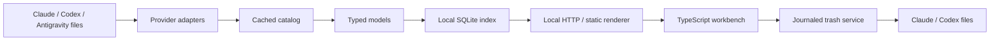

# Architecture

Session Desk runs on loopback and reads provider files directly. There is no hosted
backend, account or telemetry endpoint. A private per-workspace SQLite database
holds a rebuildable search index and user-authored reviews and notes. The Python package
contains the compiled interface, fonts and license, so installing a wheel needs no Node.

## Responsibilities

- `cli.py` validates launch options, selects real or isolated demo roots and owns lifetime.
- `background.py` manages a detached instance, private runtime state, launch locking and authenticated status/shutdown.
- `config.py` is the immutable launch configuration.
- `models.py` defines the session, memory, warning, trash and operation-result boundaries.
- The Claude, Codex and Antigravity adapters normalize provider transcript formats.
- `providers/codex_index.py` owns the optional versioned Codex SQLite index.
- `services/catalog.py` discovers files and reuses unchanged transcript metadata.
- `services/workspace.py` synchronizes the message index and serves paginated search, reviews, notes and activity.
- `services/state.py` owns roots, identities, fingerprints and scan warnings.
- `services/trash.py` journals reversible filesystem moves and recovery.
- `sessions.py` composes the catalog and trash behind a small facade.
- `rendering.py` serializes bootstrap data safely and reads packaged web resources.
- `server.py` enforces loopback, origin/token checks, bounded bodies and asset routing.
- `frontend/state.ts` owns filtering, validated browser state and context-aware links.
- `frontend/views.ts` builds pure markup from typed view state.
- `frontend/app.ts` coordinates DOM interaction and local/demo operations.
- `frontend/i18n.ts` and `icons.ts` keep translations and icon definitions separate.

The former `panel.py` module is a compatibility facade for the original entry point.
Provider code never imports a UI module. JSON fields name their meaning rather than
using the old `proj`, `msgs` and `kb` abbreviations.

## Data flow

## Recovery

IDs combine a provider with a digest of the relative provider-file path, so copied
native session IDs remain distinct. Versions combine inode, size and nanosecond mtime.
A mutation validates both the displayed version and current file before moving it.

Each removal has a unique directory under the provider's `trash/sessions-panel/` root.
A manifest records original paths and the information required to restore. Claude
session sidecars move with the transcript; memories use the same mechanism. Existing
v0.2 manifests remain readable. Recovery refuses to overwrite a newer/different file.

The current Codex SQLite schema is the only one updated; obsolete copies from previous
upgrades remain untouched. A trashed indexed transcript is archived and points to its
backup. Recovery targets the current schema even if Codex upgraded in the meantime.
Unindexed duplicates do not modify another file's index record.

Provider formats are internal and can change. Malformed metadata is normalized and
scan failures are exposed as warnings. Tests exercise locked indexes, interruptions,
changed destinations and invalid manifests using temporary directories.

## Browser state and distribution

The live HTML starts with configuration. It loads a bounded session page and a separate message page. Search returns one match
per session with a message position for navigation. Browser state tracks session
version and request identity; navigation uses stable catalog IDs. Existing review
preferences migrate from browser storage to the workspace database. Filters
discard hidden selections before bulk actions.

Static export embeds the catalog previews, CSS, fonts and bundled JavaScript.
Real-data static exports are read-only. Demo exports use synthetic data and simulate
changes in browser memory. The frontend build is a development step.

## Local index and provider boundaries

The saved catalog and readable messages are available at startup. On a persistent
workspace, a background connection checks fingerprints, reads each changed transcript
once, and publishes an atomic SQLite snapshot. WAL lets readers continue using the
previous snapshot until publication. Edits to reviews, notes and provider files wait
for the background update to finish. The panel reports progress and offers a retry if
the scan fails. An explicit launch filter using `--grep` loads synchronously to keep
the results scoped to that query. Recoverable trash and restore update the index. Connections with FTS5 trigram use it to narrow literal substring searches;
other builds evaluate the same literal query directly. The workspace key uses the
three configured roots. Use reindex to rebuild messages while preserving reviews and
notes. A note retains a source fingerprint so a changed message at the same position
doesn't silently become its new source.

Antigravity identity combines the source variant and native conversation UUID.
Recognized JSONL wins over an opaque native store. The workspace can list Antigravity
metadata even where readable text isn't available. Its adapter reads provider files
without moving or rewriting them. If a vendor summary database has uncheckpointed
WAL entries, those metadata updates become visible after the provider checkpoints.

The application manages transcripts and their sidecars, not secure erasure. Shared
provider history, caches and project files are retained. Provider-specific memory index
entries are not rewritten automatically. Compatibility is demonstrated by CI and
fixtures; undocumented future provider formats cannot be guaranteed.

## Background lifecycle

`start` launches the same Python interpreter with redirected standard streams and a
new POSIX session (detached process flags on Windows). Readiness uses a lightweight
loopback endpoint, so startup does not require scanning all transcripts. An OS-backed
launch lock serializes starts and is released automatically if the launcher exits.

A private atomic state record carries the instance UUID, token, PID, URL and launch
configuration. Status verifies the authenticated instance identity; stop requests a
graceful shutdown and never kills a PID read from disk. Shutdown waits for the catalog
mutation lock. Only the matching child removes its record, preventing stale cleanup
from deleting a replacement instance. No machine-wide service or login item is added.
